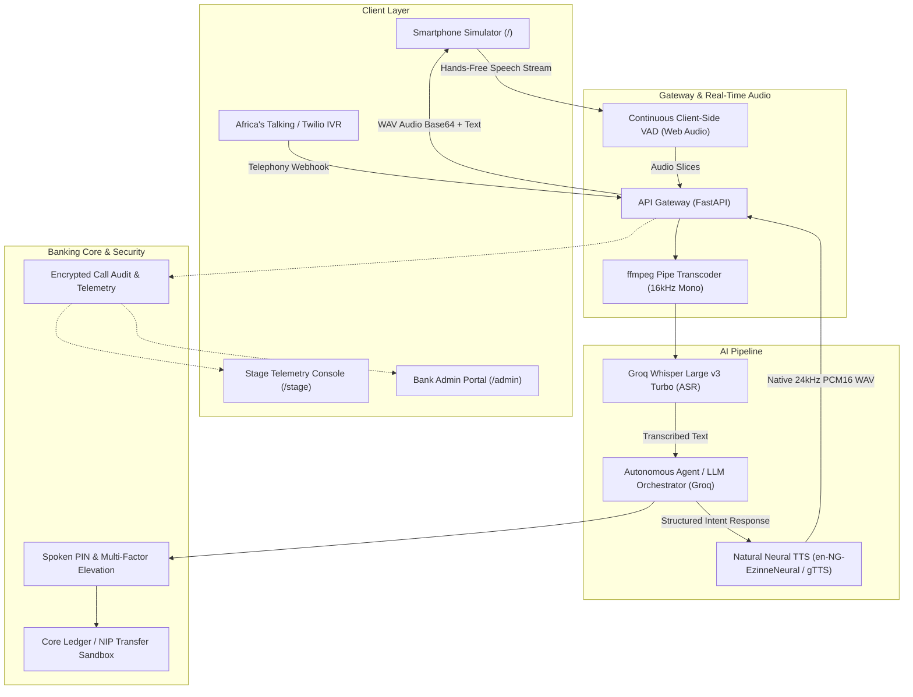
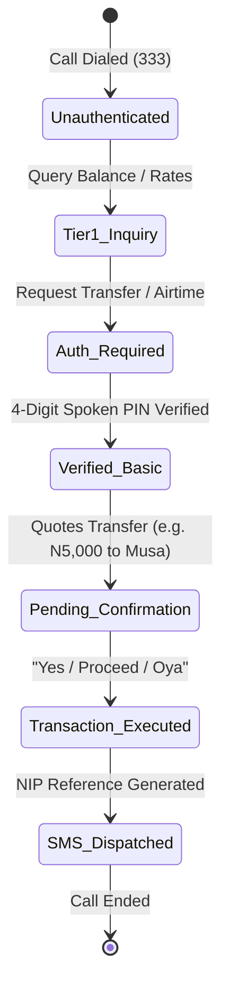

# Lyfpartner Technical Documentation: Autonomous Voice Banking Engine

> **Tagline:** Voice-first, multilingual autonomous banking for every Nigerian (Zenith Bank Zecathon 6.0 POC).

---

## 1. High-Level Architecture

Lyfpartner bridges the financial exclusion gap for the 35+ million Nigerians living with visual impairments or low digital literacy. It replaces complex text-heavy USSD menus and visual apps with an empathetic, zero-interface phone hotline.



---

## 2. Audio & Natural Voice Pipeline

### 2.1 Hands-Free Continuous Voice Activity Detection (VAD)
Unlike typical voice apps that force users to tap buttons for every turn, Lyfpartner behaves like a real phone call:
1. **Microphone Stream**: The browser initiates a Web Audio stream upon call connection (`navigator.mediaDevices.getUserMedia`).
2. **Frequency Analysis**: An `AnalyserNode` tracks room ambient noise and establishes an adaptive noise threshold.
3. **Turn Detection**:
   - Voice speaking is registered when energy breaches `1.55 * noiseFloor`.
   - When the user finishes speaking, a silence interval of **`950 ms`** triggers segment completion.
   - The audio chunk is packaged as a `Blob` and posted to `/v1/voice/turn_audio`.
4. **Echo Suppression**: While the AI assistant is speaking, the user's mic input is ignored to prevent self-triggering feedback loops.

### 2.2 Live Speech-to-Text (ASR)
- **Engine**: Groq Cloud running `whisper-large-v3-turbo`.
- **Transcoding**: Incoming browser audio (`audio/webm;codecs=opus` or `audio/mp4`) is dynamically piped through `ffmpeg` into standardized single-channel 16kHz WAV format before reaching Whisper.
- **Multilingual Support**: Supports code-switching across **Nigerian English, Hausa, Yoruba, and Igbo**.

### 2.3 Natural Neural Text-to-Speech (TTS)
- **Nigerian English**: Powered by Microsoft Edge Neural TTS with voice **`en-NG-EzinneNeural`** (warm, authentic female Nigerian tone).
- **Speed & Cadence**: Synthesized with `rate="+8%"` to prevent audio dragging.
- **Native Sample Rate Encoding**: Audio is decoded and saved into PCM 16-bit WAV at its native **`24 kHz`** rate so that the Web Audio `AudioContext` renders it at authentic human pitch and speed.
- **Local Languages**: Hausa, Yoruba, and Igbo utilize low-latency neural synthesis.

---

## 3. Financial Security & State Machine



### Security Safeguards
1. **Multi-Factor Elevation**: Balance queries are public; money transfers, bill payments, and airtime top-ups require explicit 4-digit spoken PIN verification.
2. **Deterministic Banking Overrides**: While general chit-chat and explanations are handled by the LLM, critical monetary actions (balance deduction, PIN verification, NIP transaction reference generation) are hard-gated by strict deterministic rules.
3. **Two-Step Affirmation**: Critical money movement mandates explicit verbal confirmation before the ledger executes the debit.

---

## 4. Independent View Architectures

| Route | Role | Design & Target Device | Key Components |
|---|---|---|---|
| **`/`** | **Phone Simulator** | Mobile-First (Pure CSS Bezel, 340px) | • Pure CSS metallic hardware mockup<br>• Dynamic Island live waveform<br>• Hands-Free VAD<br>• iOS keypad & live captions |
| **`/stage`** | **Live Telemetry Console** | Desktop / Stage Projectors (16:9) | • Live execution pipeline trace<br>• NIP ledger event feed<br>• Turn latency telemetry<br>• Presenter scaling mode (`P` key) |
| **`/admin`** | **Bank Operations Portal** | Desktop Enterprise Portal | • Staff auth gate (`OP-77402`)<br>• Call recording & transcript inspector<br>• Fraud escalation queue<br>• CBN audit trail |

---

## 5. End-to-End Verification & API Reference

### Key Backend Endpoints
- **`POST /v1/sessions`**: Initializes a call session with caller phone number and selected language code.
- **`POST /v1/voice/turn_audio`**: Receives raw audio chunks from the client VAD, performs Groq Whisper transcription, updates conversational state, and returns reply text + WAV base64 audio.
- **`POST /v1/voice/turn`**: Text-based fallback for programmatic turns or DTMF keypad inputs.
- **`POST /v1/tts/speak`**: Generates instant audio bytes for given text in Nigerian English, Hausa, Yoruba, or Igbo.
- **`GET /health`**: Health check returning service version and operational status.

### Running Tests Locally
```bash
source .venv/bin/activate
python -m pytest -v
```
All **14 test suites** (including the 7 E2E hackathon demo scripts) run in `<15s` with 100% green status.
