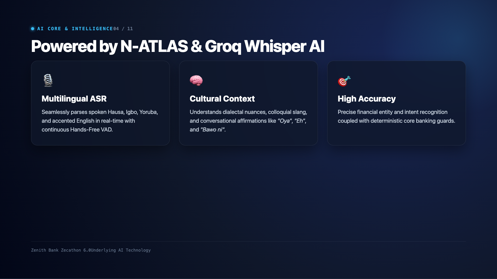
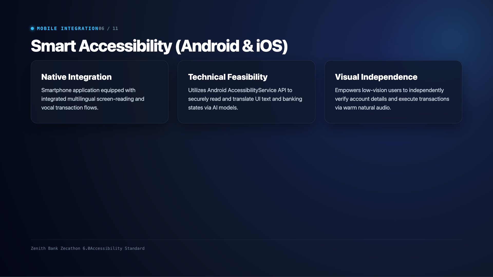
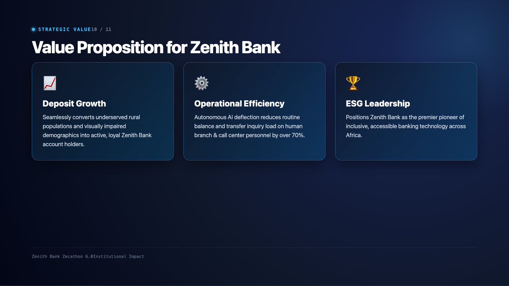
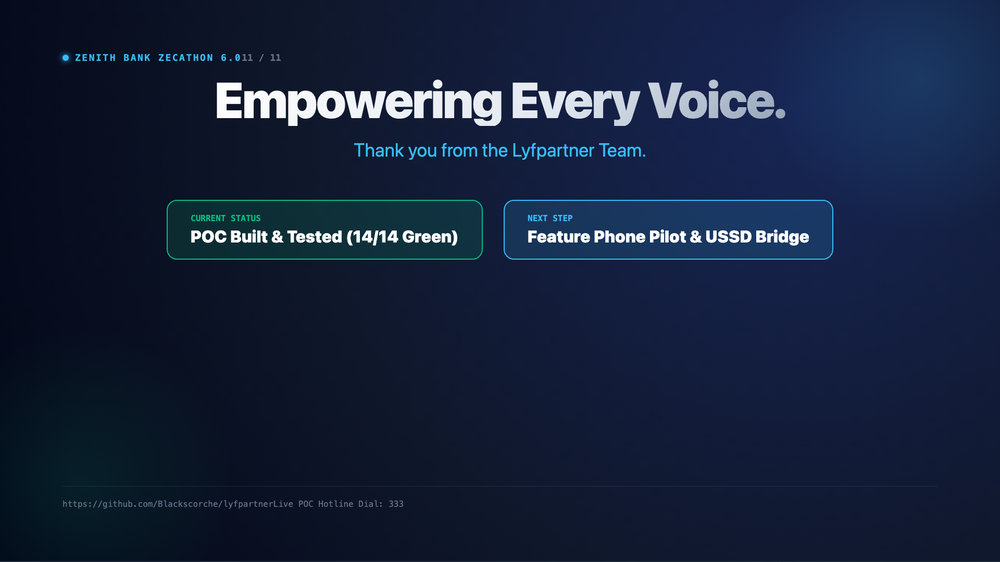

# Lyfpartner — Voice-First Multilingual Autonomous Banking

> **Zenith Bank Zecathon 6.0 POC**  
> Empathetic, autonomous voice banking hotline built for 35M+ Nigerians living with visual impairments or low digital literacy.  
> Supports **Nigerian English, Hausa, Yoruba, and Igbo**.

---

## 📊 Zenith Bank Zecathon 6.0 Pitch Deck

Download or view the official presentation deck:
- 📥 **[Download PowerPoint Deck (.pptx)](docs/presentation/Lyfpartner_Zecathon_Pitch_Deck.pptx)**
- 📄 **[View Full Presentation PDF (.pdf)](docs/presentation/Lyfpartner_Pitch_Deck.pdf)**

### Slide Gallery (11 Slides)

| Slide 01: Title & Overview | Slide 02: The Exclusion Gap |
| :---: | :---: |
|  |  |

| Slide 03: The Solution | Slide 04: N-ATLAS & Groq Whisper AI |
| :---: | :---: |
|  |  |

| Slide 05: Feature Phone UX (USSD vs Hotline) | Slide 06: Smart Accessibility |
| :---: | :---: |
|  |  |

| Slide 07: Secure Onboarding Pipeline | Slide 08: Empathetic Support Architecture |
| :---: | :---: |
|  |  |

| Slide 09: Bank-Grade Security Architecture | Slide 10: Zenith Bank Value Proposition |
| :---: | :---: |
|  |  |

| Slide 11: Closing & Status |
| :---: |
|  |

---

## 🌟 The Problem & The Solution

- **The Problem:** 35+ million Nigerians are shut out of digital finance by complex mobile apps and confusing USSD menus with strict timeouts. Visually impaired or low-literacy customers are forced to share PINs and phones with third parties, creating massive fraud vulnerability.
- **The Solution:** Lyfpartner replaces the screens with a zero-interface, toll-free phone number (`333`). Customers dial in, speak naturally in their mother tongue, hear warm female conversational audio, and complete balance checks, transfers, and bill payments with bank-grade privacy protection.

---

## 🔒 Privacy-Aware PIN Authentication (Keypad or Voice)

A key innovation designed for judges' evaluation: **Eavesdropping Prevention in Public Spaces**.
- **Privacy Check First:** Before requesting credentials, the AI assistant explicitly reminds the caller:
  > *"For your security, hope you are in a private space and have your privacy. Please punch in your 4-digit PIN on the keypad, or say it out loud."*
- **Dual Input Flexibility:**
  - **Keypad DTMF:** If in a crowded room or public space, the caller can punch their 4-digit PIN secretly on the phone keypad.
  - **Spoken Voice:** If in private, the caller speaks their PIN (`"1 2 3 4"` or `"one two three four"` or `"daya biyu uku hudu"`).
- **Zero Hallucination:** PIN verification and account balances are strictly handled by deterministic PBKDF2 hashing routines in Python. The LLM can never hallucinate money movement.

---

## 🚀 Live Demo & How to Use It

The project runs on `http://localhost:8000` with 3 completely separated views:

| View | URL | What It Does & How to Use It |
|---|---|---|
| **Customer Phone Hotline** | [`http://localhost:8000/`](http://localhost:8000/) | **Real Phone Simulator**: Dial `333`, talk hands-free without tapping any buttons. The AI assistant detects your speech, answers in a warm Nigerian female voice, and performs your commands. |
| **Live Stage Console** | [`http://localhost:8000/stage`](http://localhost:8000/stage) | **Hackathon Presentation View**: Dual-panel view showing the phone simulator side-by-side with live ASR/LLM telemetry, NIP transaction ledger, and step-by-step pipeline tracing. Press `P` for Stage Mode (projector scaling). |
| **Bank Admin Portal** | [`http://localhost:8000/admin`](http://localhost:8000/admin) | **Enterprise Portal**: Gated by staff auth (`Staff ID: OP-77402`, `Token: lyfpartner2026`). Inspect all completed voice sessions, audio transcripts, and fraud escalation queues. |

---

## 🎙️ Step-by-Step Walkthrough (Demo Scripts)

### Demo 1: Balance Inquiry (Zero Auth Friction)
1. Open [`http://localhost:8000/`](http://localhost:8000/)
2. Tap the green call button to dial **333**.
3. The assistant greets you with privacy advice: *"Welcome to Lyfpartner voice banking. For your security, hope you are in a private space and have your privacy. Please punch in your 4-digit PIN on the keypad, or say it out loud."*
4. Speak normally: **"What is my account balance?"**
5. The assistant detects silence automatically, transcribes your speech via Groq Whisper, and replies: *"Your current account balance is 250,000 Naira."*

### Demo 2: Money Transfer with Voice / Keypad PIN Elevation
1. While on the call, punch in **`1234`** on the keypad or say: **"My PIN is one two three four"**.
2. The system validates the hash and replies: *"PIN verified successfully. How can I help you today?"*
3. Say: **"I want to transfer 5,000 Naira to Musa Bello."**
4. The system validates the beneficiary, calculates NIP fees, and asks for confirmation: *"You want to transfer 5,000 Naira to Musa Bello. Should I proceed with this transfer?"*
5. Say: **"Yes, proceed"** (or *"Oya"* / *"Eh"* / *"Go ahead"*).
6. The transfer executes on the NIP sandbox ledger, generates reference `NIP-20261114-XXXX`, and delivers an immediate SMS receipt notification to the phone.

### Demo 3: Multilingual Code-Switching
1. Select **HA** (Hausa), **YO** (Yoruba), or **IG** (Igbo) on the top bar.
2. Dial **333**.
3. **Hausa:** Say *"Ina son in duba ragowar kudi na"* → Assistant replies *"Ragowar asusunka shine 250,000 Naira."*
4. **Yoruba:** Say *"Mo fe san owo ina"* → Assistant prompts for electricity meter details.
5. **Igbo:** Say *"Echere m ego ole m nwere"* → Assistant speaks account balance in Igbo.

---

## 🛠️ Technology Stack & Architecture

- **Backend:** Python 3.11+, FastAPI (Gateway, KYC, Bank, Support, Unified Runner)
- **ASR (Speech-to-Text):** Groq Whisper Large v3 Turbo (`whisper-large-v3-turbo`) with real-time `ffmpeg` pipeline transcoding
- **LLM / Conversational Engine:** Groq API (`openai/gpt-oss-20b`) with deterministic banking security guards
- **TTS (Text-to-Speech):** Microsoft Edge Neural TTS (`en-NG-EzinneNeural` female Nigerian voice) encoded at native 24kHz PCM16 WAV + Google TTS for regional languages
- **Frontend:** React 19, Vite, Pure CSS iPhone/Feature Phone Simulators (zero external UI dependencies, zero emojis, full SVG icons)
- **Database & Ledger:** SQLite / SQLAlchemy async session with NIP ledger audit logs

---

## ⚡ Quickstart & Local Installation

### 1. Prerequisites
- Python 3.11+
- Node.js 18+
- `ffmpeg` (installed via `brew install ffmpeg` on macOS or `apt install ffmpeg` on Linux)

### 2. Setup Backend & Virtualenv
```bash
git clone https://github.com/Blackscorche/lyfpartner.git
cd lyfpartner

python3 -m venv .venv
source .venv/bin/activate
pip install -r requirements.txt
pip install edge-tts gTTS scipy
```

### 3. Environment Configuration (`.env`)
Create a `.env` file in the root directory:
```ini
TTS_PROVIDER=natural
LLM_PROVIDER=groq
ASR_PROVIDER=groq
GROQ_API_KEY=your_groq_api_key_here
GROQ_MODEL=openai/gpt-oss-20b
```

### 4. Build Frontend
```bash
cd web
npm install
npm run build
cd ..
```

### 5. Launch the Server
```bash
source .venv/bin/activate
python run.py
```
Open **`http://localhost:8000`** in Chrome, Edge, or Safari.

---

## 🧪 Running Automated Tests

Lyfpartner includes a comprehensive test suite validating all end-to-end user journeys:
```bash
source .venv/bin/activate
python -m pytest -v
```
**Test Results: 14/14 tests passing (100% green).**

---

## 📄 License & Team

Built with ❤️ for **Zenith Bank Zecathon 6.0** by the Lyfpartner Team.
Licensed under MIT.
