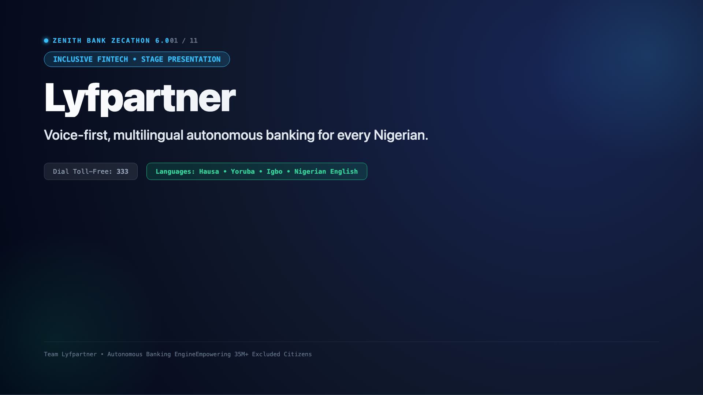
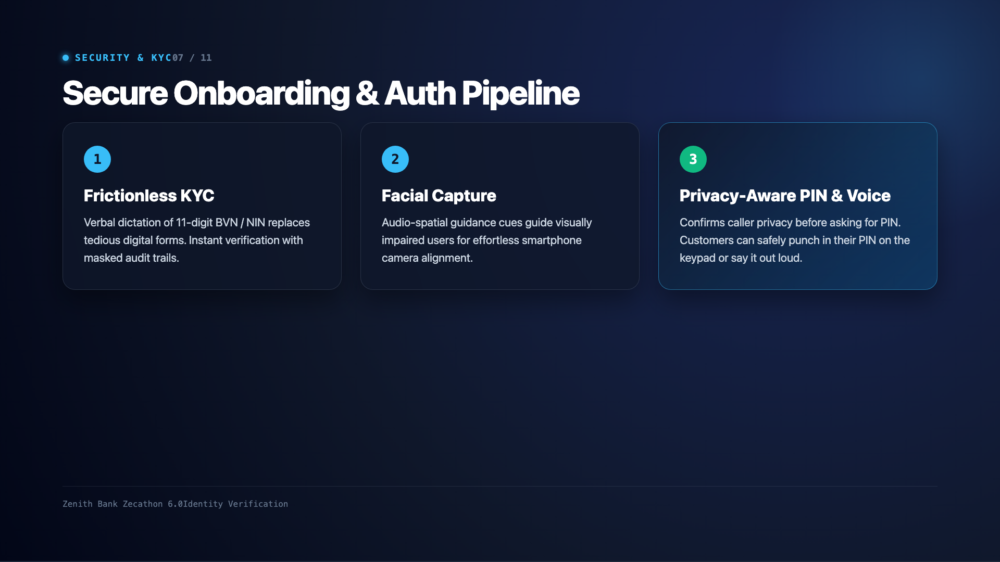
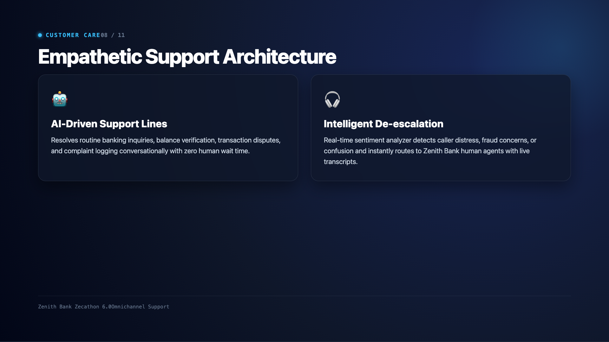
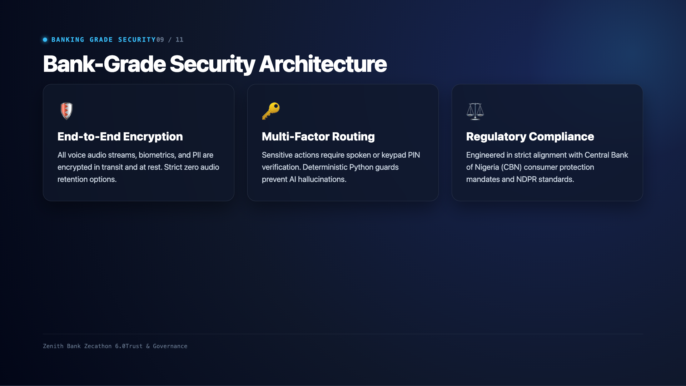

# Lyfpartner — Voice-First Multilingual Autonomous Banking

> **Zenith Bank Zecathon 6.0 POC**  
> Empathetic, autonomous voice banking hotline built for 35M+ Nigerians living with visual impairments or low digital literacy.  
> Supports **Nigerian English, Hausa, Yoruba, and Igbo**.

🔗 **Live Demo:** [lyfpartner-production.up.railway.app](https://lyfpartner-production.up.railway.app)

---

## 📊 Zenith Bank Zecathon 6.0 Pitch Deck

Download or view the official presentation deck:
- 📥 **[Download PowerPoint Deck (.pptx)](docs/presentation/Lyfpartner_Zecathon_Pitch_Deck.pptx)**
- 📄 **[View Full Presentation PDF (.pdf)](docs/presentation/Lyfpartner_Pitch_Deck.pdf)**

### Slide Gallery (11 Slides)

| Slide 01: Title & Overview | Slide 02: The Exclusion Gap |
| :---: | :---: |
|  |  |

| Slide 03: The Solution | Slide 04: N-ATLAS & Groq Whisper AI |
| :---: | :---: |
|  |  |

| Slide 05: Feature Phone UX (USSD vs Hotline) | Slide 06: Smart Accessibility |
| :---: | :---: |
|  |  |

| Slide 07: Secure Onboarding Pipeline | Slide 08: Empathetic Support Architecture |
| :---: | :---: |
|  |  |

| Slide 09: Bank-Grade Security Architecture | Slide 10: Zenith Bank Value Proposition |
| :---: | :---: |
|  |  |

| Slide 11: Closing & Status |
| :---: |
|  |

---

## 🌟 The Problem & The Solution

- **The Problem:** 35+ million Nigerians are shut out of digital finance by complex mobile apps and confusing USSD menus with strict timeouts. Visually impaired or low-literacy customers are forced to share PINs and phones with third parties, creating massive fraud vulnerability.
- **The Solution:** Lyfpartner replaces the screens with a zero-interface, toll-free phone number (`333`). Customers dial in, speak naturally in their mother tongue, hear a warm Nigerian female voice, and complete balance checks, transfers, and bill payments — no smartphone, no data, no literacy required.

---

## 🤖 AI Engine — Fully Conversational (Not Robotic IVR)

Unlike traditional IVR systems that play pre-recorded clips and force "press 1 for balance", Lyfpartner uses a **fully live Groq LLM** (`llama-3.3-70b-versatile`) to power every single turn of the conversation.

### How it works:
- **Natural intent detection** — The AI understands what the caller wants from freeform speech, in any of the 4 languages, without keyword menus.
- **Conversational-first flow** — On connect, the AI greets warmly and asks *what you need*, never demanding a PIN upfront. PIN is only requested after the caller states their intent.
- **Real account context** — The AI is told the caller's live balance and saved beneficiaries before each response, so it speaks to their actual situation.
- **Multi-turn memory & slot filling** — The AI naturally collects missing information step-by-step (e.g. amount, 10-digit NUBAN account number, bank name, meter number, or data plan) across turns.
- **Mid-flow digression & correction** — Callers can pause mid-transaction to check their balance (*"wait, what is my balance?"*), modify amounts (*"make it 7000 instead"*), or cancel cleanly without breaking context.
- **Zero hallucination on money** — All financial transactions (PIN verification, NIP transfer execution, DisCo bill payments, VTU airtime/data purchases) are handled by deterministic Python routines. The LLM can never invent or move money.

### Groq handles:
Greetings · Natural intent recognition · Conversational clarification · Help questions · Language switching · Spoken summaries · Contextual guidance

### Deterministic code handles:
PIN hash verification (PBKDF2) · NIP transfer execution · Unsaved beneficiary NUBAN validation · DisCo meter verification & 20-digit token generation · Telco airtime & data bundle execution · SMS receipt delivery · Transfer confirmation & cancellation

---

## 🔒 Privacy-Aware PIN Authentication

A key innovation: **Eavesdropping Prevention in Public Spaces**.

- **Privacy Check First:** Before requesting credentials, the AI reminds the caller they should be in a private space.
- **Dual Input Flexibility:**
  - **Keypad DTMF:** Caller punches their 4-digit PIN secretly on the phone keypad (eavesdrop-safe).
  - **Spoken Voice:** Caller says their PIN aloud (`"1 2 3 4"` or `"one two three four"` or `"daya biyu uku hudu"` in Hausa).
- **Bank-grade hashing:** PINs are verified with PBKDF2-SHA256. Never stored in plaintext, never sent to the LLM.

---

## 🎙️ Instant Barge-In (AI Stops When You Speak)

The moment the caller starts talking, the AI's audio cuts off instantly — no waiting for it to finish. This is implemented via:
- `SpeechRecognition.onspeechstart` / `onsoundstart` → immediate `stopSpeaking()` call
- Dual audio kill: pauses HTML5 `Audio` node + cancels `AudioContext` source node simultaneously
- Lowered VAD barge-in threshold for hair-trigger responsiveness

---

## 🌍 4-Language Neural TTS Voices

| Language | Voice |
|---|---|
| Nigerian English | Microsoft Edge Neural — `en-NG-EzinneNeural` (female) |
| Hausa | Google TTS — `ha` |
| Yoruba | Microsoft Edge Neural — `en-NG-EzinneNeural` (fallback) |
| Igbo | Microsoft Edge Neural — `en-NG-EzinneNeural` (fallback) |

All audio is returned as base64-encoded PCM WAV per turn — no streaming dependency, works on any browser.

---

## 🚀 Live Demo & How to Use It

**Live URL:** [https://lyfpartner-production.up.railway.app](https://lyfpartner-production.up.railway.app)

| View | URL | Description |
|---|---|---|
| **Customer Phone** | `/` | Pure voice call simulator — tap the green call button and speak naturally |
| **Stage Console** | `/stage` | Hackathon presentation view with live ASR/LLM telemetry, NIP ledger, pipeline tracing |
| **Bank Admin Portal** | `/admin` | Staff portal — `Staff ID: OP-77402`, `Token: lyfpartner2026` |

---

## 🎬 Demo Scripts (Step-by-Step)

### Demo 1: Balance Inquiry
1. Open the live URL and tap the green call button.
2. The AI greets you warmly and asks what you need (no upfront PIN demand).
3. Say: **"What is my account balance?"**
4. The AI acknowledges and asks for your 4-digit PIN with a privacy reminder.
5. Say: **"1 2 3 4"** (or punch it on the keypad).
6. Balance is read back: *"Your account balance is 250,000 Naira."*

### Demo 2: Money Transfer (Saved Beneficiary)
1. After greeting, say: **"I want to send 5,000 Naira to Musa."**
2. AI confirms the intent, asks for your PIN with an eavesdropping privacy prompt.
3. Enter PIN (`1234`) $\rightarrow$ AI generates a real NIP quote with transaction fees: *"Confirm transfer of 5,000 Naira to Musa Ibrahim (Zenith Bank). Fee is 10 Naira. Should I go ahead?"*
4. Say: **"Yes"** / **"Proceed"** / **"Oya"**
5. Transfer executes instantly, balance debited, and SMS receipt dispatched.

### Demo 3: Money Transfer to Unsaved Beneficiary
1. Say: **"I want to transfer 10,000 Naira."**
2. AI asks who you want to send money to.
3. Say: **"Ibrahim"** (not in your saved beneficiaries).
4. AI asks for Ibrahim's 10-digit account number and destination bank.
5. Say: **"Account 0123456789 GTBank."**
6. AI validates the NUBAN details, prompts for PIN, quotes the transfer, and executes upon your spoken confirmation.

### Demo 4: Bill Payment with Meter Verification & Token Generation
1. Say: **"I want to pay my NEPA electricity bill."**
2. AI asks for your meter number.
3. Say: **"45129038101"**
4. AI contacts the DisCo, verifies customer name (*"Aminu Kano"*), and asks how much you'd like to pay.
5. Say: **"3,000 Naira"** $\rightarrow$ Enter PIN $\rightarrow$ Spoken confirmation.
6. Payment succeeds! AI speaks your 20-digit electricity recharge token (`0481-9283-7182-9384-5120`) and dispatches it immediately via SMS.

### Demo 5: VTU Airtime Top-Up
1. Say: **"I want to buy airtime."**
2. AI detects your carrier from your phone prefix (e.g., MTN for `0803`, Airtel for `0802`) and asks for the amount.
3. Say: **"1,000 Naira"** (or in one turn: *"Recharge 1000 MTN"*).
4. Enter PIN $\rightarrow$ Confirm with *"Yes"* $\rightarrow$ Airtime topped up with SMS receipt.

### Demo 6: Internet Data Bundle Purchase
1. Say: **"I want to buy data."**
2. AI asks which plan you want (options: `1GB` @ 500 NGN, `2.5GB` @ 1,000 NGN, `5GB` @ 1,500 NGN, `10GB` @ 3,000 NGN).
3. Say: **"2.5GB"** (or in one turn: *"Buy 2.5GB data bundle"*).
4. AI quotes the bundle and prompts for PIN.
5. Enter PIN $\rightarrow$ Confirm with *"Yes"* $\rightarrow$ Data bundle activated instantly with SMS confirmation.

### Demo 7: Mid-Flow Digressions & Corrections
1. In the middle of any transfer quote, say: **"Wait, what is my balance?"**
2. AI states your balance and offers to resume your pending transfer without restarting.
3. Say: **"Change amount to 7,000"** $\rightarrow$ AI updates the amount dynamically.
4. Say: **"Cancel"** $\rightarrow$ AI safely cancels the pending action with zero penalty.

### Demo 8: Multilingual Voice Banking
1. Select **HA**, **YO**, or **IG** on the top language selector (or speak naturally in your dialect).
2. AI switches language dynamically and responds in the exact same tongue:
   - **Hausa:** *"Ina son in duba ragowar kudi na"* $\rightarrow$ Balance check in Hausa.
   - **Yoruba:** *"Mo fe san owo ina"* $\rightarrow$ Electricity bill flow in Yoruba.
   - **Igbo:** *"Achọrọ m izipu puku ise nye Musa"* $\rightarrow$ 5,000 Naira transfer to Musa in Igbo.

---

## 🛠️ Technology Stack

| Layer | Technology | Description |
|---|---|---|
| **Backend** | Python 3.11+, FastAPI (unified server) | Async pipeline, rate limiting, request correlation |
| **ASR (Speech-to-Text)** | Groq Whisper Large v3 Turbo (`whisper-large-v3-turbo`) | Sub-second audio transcription with multilingual code-switching |
| **LLM Reasoning** | Groq API — `llama-3.3-70b-versatile` / `qwen/qwen3.8-27b` | Conversational dialogue, intent extraction, slot filling |
| **TTS (Text-to-Speech)** | Microsoft Edge Neural TTS (`en-NG-EzinneNeural`) + Google TTS | Warm Nigerian female neural voice & native language synthesis |
| **Browser Audio & VAD** | WebM audio chunks + Web Audio API | Instant barge-in, browser-independent fallback for Brave/Edge/Chrome/Safari |
| **Database & Ledger** | SQLite + SQLAlchemy async | ACID NIP ledger, audit logs, idempotency tokens |
| **Deployment** | Railway (auto-deploy from GitHub `main`) | Multi-stage Dockerized build with health checks |

---

## ⚡ Quickstart — Local Setup

### Prerequisites
- Python 3.11+, Node.js 18+, `ffmpeg`

```bash
# Clone
git clone https://github.com/Blackscorche/lyfpartner.git
cd lyfpartner

# Backend
python3 -m venv .venv
source .venv/bin/activate
pip install -r requirements.txt

# Frontend
cd web && npm install && npm run build && cd ..

# Environment — create .env
LLM_PROVIDER=groq
TTS_PROVIDER=natural
ASR_PROVIDER=groq
GROQ_API_KEY=your_groq_api_key_here
GROQ_MODEL=llama-3.3-70b-versatile  # or qwen/qwen3.8-27b

# Run
python run.py
```

Open **`http://localhost:8000`** in Chrome, Brave, Edge, or Safari.

---

## 🧪 Automated Tests

```bash
source .venv/bin/activate
pytest tests/ -v
```

**30/30 tests passing — 100% green.**  
Test coverage includes:
- Multi-turn conversational transfers (saved & unsaved beneficiaries)
- DisCo pre-payment customer validation & 20-digit token generation
- VTU Airtime and Internet Data bundle end-to-end multi-turn flows
- Spoken and keypad DTMF PIN authentication & privacy elevation
- Mid-flow digressions (balance check mid-transfer) and mid-flow corrections
- Multilingual Hausa, Yoruba, Igbo, and Nigerian English dialogue
- Admin security, audit logging, and NIP financial ledger immutability

---

## 📄 License & Team

Built with ❤️ for **Zenith Bank Zecathon 6.0** by the Lyfpartner Team.  
Licensed under MIT.
