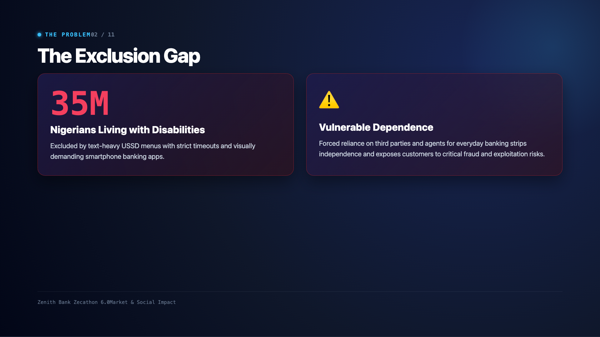
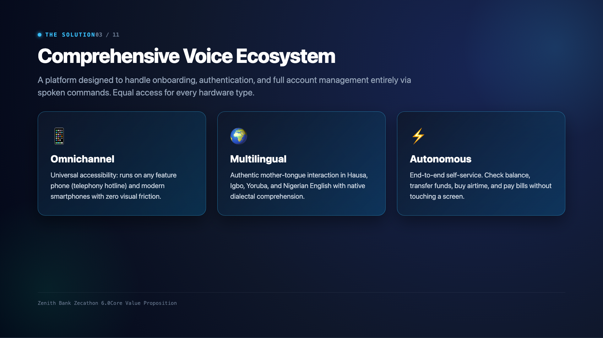
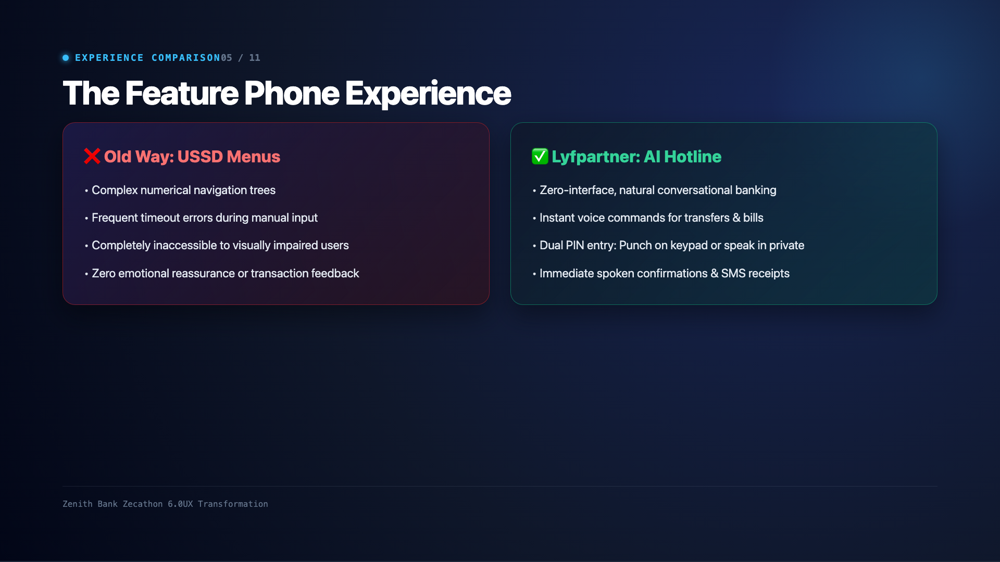

# Lyfpartner — Voice-First Multilingual Autonomous Banking

> **Zenith Bank Zecathon 6.0 POC**  
> Empathetic, autonomous voice banking hotline built for 35M+ Nigerians living with visual impairments or low digital literacy.  
> Supports **Nigerian English, Hausa, Yoruba, and Igbo**.

🔗 **Live Demo:** [lyfpartner-production.up.railway.app](https://lyfpartner-production.up.railway.app)

---

## 📊 Zenith Bank Zecathon 6.0 Pitch Deck

Download or view the official presentation deck:
- 📥 **[Download PowerPoint Deck (.pptx)](docs/presentation/Lyfpartner_Zecathon_Pitch_Deck.pptx)**
- 📄 **[View Full Presentation PDF (.pdf)](docs/presentation/Lyfpartner_Pitch_Deck.pdf)**

### Slide Gallery (11 Slides)

| Slide 01: Title & Overview | Slide 02: The Exclusion Gap |
| :---: | :---: |
|  |  |

| Slide 03: The Solution | Slide 04: N-ATLAS & Groq Whisper AI |
| :---: | :---: |
|  |  |

| Slide 05: Feature Phone UX (USSD vs Hotline) | Slide 06: Smart Accessibility |
| :---: | :---: |
|  |  |

| Slide 07: Secure Onboarding Pipeline | Slide 08: Empathetic Support Architecture |
| :---: | :---: |
|  |  |

| Slide 09: Bank-Grade Security Architecture | Slide 10: Zenith Bank Value Proposition |
| :---: | :---: |
|  |  |

| Slide 11: Closing & Status |
| :---: |
|  |

---

## 🌟 The Problem & The Solution

- **The Problem:** 35+ million Nigerians are shut out of digital finance by complex mobile apps and confusing USSD menus with strict timeouts. Visually impaired or low-literacy customers are forced to share PINs and phones with third parties, creating massive fraud vulnerability.
- **The Solution:** Lyfpartner replaces the screens with a zero-interface, toll-free phone number (`333`). Customers dial in, speak naturally in their mother tongue, hear a warm Nigerian female voice, and complete balance checks, transfers, and bill payments — no smartphone, no data, no literacy required.

---

## 🤖 AI Engine — Fully Conversational (Not Robotic IVR)

Unlike traditional IVR systems that play pre-recorded clips and force "press 1 for balance", Lyfpartner uses a **fully live Groq LLM** (`llama-3.3-70b-versatile`) to power every single turn of the conversation.

### How it works:
- **Natural intent detection** — The AI understands what the caller wants from freeform speech, in any of the 4 languages, without keyword menus.
- **Conversational-first flow** — On connect, the AI greets warmly and asks *what you need*, never demanding a PIN upfront. PIN is only requested after the caller states their intent.
- **Real account context** — The AI is told the caller's live balance and saved beneficiaries before each response, so it speaks to their actual situation.
- **Multi-turn memory** — The AI remembers what was just said and maintains a coherent conversation across turns.
- **Zero hallucination on money** — All financial transactions (PIN verification, transfer execution, bill payment) are handled by deterministic Python routines. The LLM can never invent or move money.

### Groq handles:
Greetings · Intent acknowledgment · PIN prompts · Help questions · Language clarification · Small talk · Anything conversational

### Deterministic code handles:
PIN hash verification (PBKDF2) · Transfer execution (NIP ledger) · Bill payment · SMS receipt delivery · Transfer confirmation/cancellation

---

## 🔒 Privacy-Aware PIN Authentication

A key innovation: **Eavesdropping Prevention in Public Spaces**.

- **Privacy Check First:** Before requesting credentials, the AI reminds the caller they should be in a private space.
- **Dual Input Flexibility:**
  - **Keypad DTMF:** Caller punches their 4-digit PIN secretly on the phone keypad (eavesdrop-safe).
  - **Spoken Voice:** Caller says their PIN aloud (`"1 2 3 4"` or `"one two three four"` or `"daya biyu uku hudu"` in Hausa).
- **Bank-grade hashing:** PINs are verified with PBKDF2-SHA256. Never stored in plaintext, never sent to the LLM.

---

## 🎙️ Instant Barge-In (AI Stops When You Speak)

The moment the caller starts talking, the AI's audio cuts off instantly — no waiting for it to finish. This is implemented via:
- `SpeechRecognition.onspeechstart` / `onsoundstart` → immediate `stopSpeaking()` call
- Dual audio kill: pauses HTML5 `Audio` node + cancels `AudioContext` source node simultaneously
- Lowered VAD barge-in threshold for hair-trigger responsiveness

---

## 🌍 4-Language Neural TTS Voices

| Language | Voice |
|---|---|
| Nigerian English | Microsoft Edge Neural — `en-NG-EzinneNeural` (female) |
| Hausa | Google TTS — `ha` |
| Yoruba | Microsoft Edge Neural — `en-NG-EzinneNeural` (fallback) |
| Igbo | Microsoft Edge Neural — `en-NG-EzinneNeural` (fallback) |

All audio is returned as base64-encoded PCM WAV per turn — no streaming dependency, works on any browser.

---

## 🚀 Live Demo & How to Use It

**Live URL:** [https://lyfpartner-production.up.railway.app](https://lyfpartner-production.up.railway.app)

| View | URL | Description |
|---|---|---|
| **Customer Phone** | `/` | Pure voice call simulator — tap the green call button and speak naturally |
| **Stage Console** | `/stage` | Hackathon presentation view with live ASR/LLM telemetry, NIP ledger, pipeline tracing |
| **Bank Admin Portal** | `/admin` | Staff portal — `Staff ID: OP-77402`, `Token: lyfpartner2026` |

---

## 🎬 Demo Scripts (Step-by-Step)

### Demo 1: Balance Inquiry
1. Open the live URL and tap the green call button.
2. The AI greets you warmly and asks what you need (no PIN demand).
3. Say: **"What is my account balance?"**
4. The AI acknowledges, tells you to enter your PIN for security.
5. Say: **"1 2 3 4"** or punch it on the keypad.
6. Balance is read back: *"Your account balance is 250,000 Naira."*

### Demo 2: Money Transfer
1. After greeting, say: **"I want to send 5,000 Naira to Musa."**
2. AI confirms the intent and asks for PIN (privacy reminder included).
3. Enter PIN → AI confirms amount & beneficiary → asks *"Should I go ahead?"*
4. Say: **"Yes"** / **"Oya"** / **"Proceed"**
5. Transfer executes, SMS receipt sent.

### Demo 3: Multilingual
1. Select **HA**, **YO**, or **IG** language on the top bar.
2. Speak in that language — AI responds in the same language end-to-end.
3. Hausa: *"Ina son in duba ragowar kudi na"* → balance in Hausa.
4. Yoruba: *"Mo fe san owo ina"* → electricity bill flow in Yoruba.

---

## 🛠️ Technology Stack

| Layer | Technology |
|---|---|
| Backend | Python 3.11+, FastAPI (unified server) |
| ASR | Groq Whisper Large v3 Turbo (`whisper-large-v3-turbo`) |
| LLM | Groq API — `llama-3.3-70b-versatile` (all dialogue turns) |
| TTS | Microsoft Edge Neural TTS (`en-NG-EzinneNeural`) + Google TTS |
| Frontend | React 19, Vite, pure CSS phone UI |
| Database | SQLite + SQLAlchemy async (NIP ledger, audit logs) |
| Deployment | Railway (auto-deploy from GitHub `main`) |

---

## ⚡ Quickstart — Local Setup

### Prerequisites
- Python 3.11+, Node.js 18+, `ffmpeg`

```bash
# Clone
git clone https://github.com/Blackscorche/lyfpartner.git
cd lyfpartner

# Backend
python3 -m venv .venv
source .venv/bin/activate
pip install -r requirements.txt

# Frontend
cd web && npm install && npm run build && cd ..

# Environment — create .env
LLM_PROVIDER=groq
TTS_PROVIDER=natural
ASR_PROVIDER=groq
GROQ_API_KEY=your_groq_api_key_here
GROQ_MODEL=llama-3.3-70b-versatile

# Run
python run.py
```

Open **`http://localhost:8000`** in Chrome, Edge, or Safari.

---

## 🧪 Automated Tests

```bash
source .venv/bin/activate
pytest -v
```

**15/15 tests passing — 100% green.**  
Tests run with mocked LLM/TTS providers so they never hit the network.

---

## 📄 License & Team

Built with ❤️ for **Zenith Bank Zecathon 6.0** by the Lyfpartner Team.  
Licensed under MIT.
